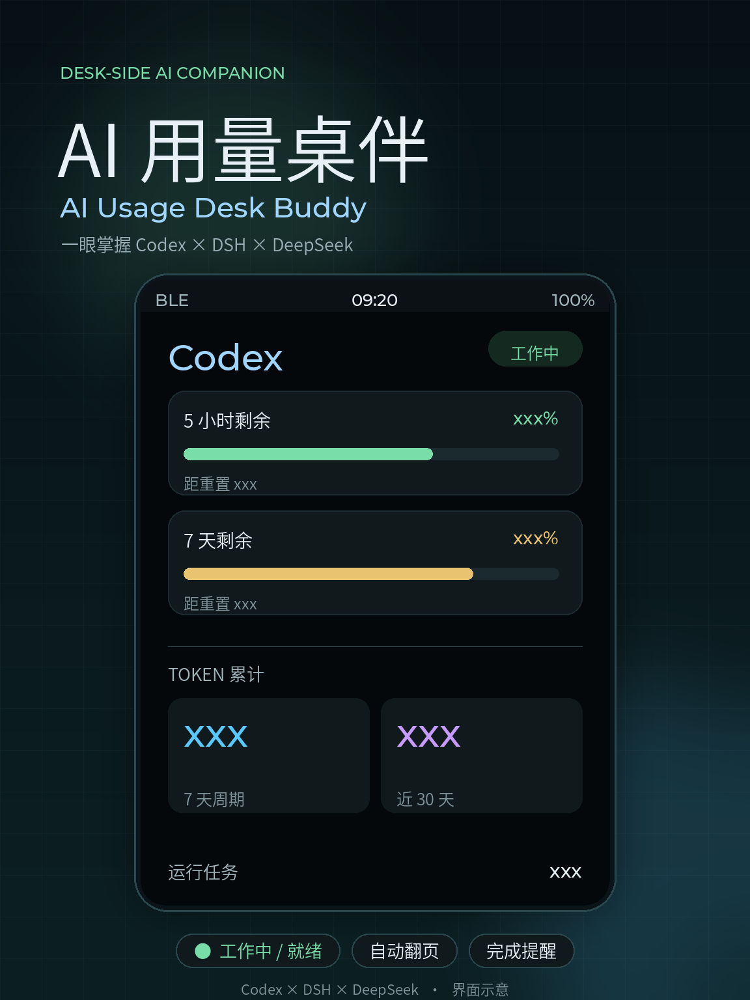

# AI 用量桌伴 · AI Usage Desk Buddy

**简体中文** · [English](README.md)

<p align="center">
  
  
</p>

*界面示意，所有数值均为占位符。*

作者：**KwoYeung**

把 AI Passport 变成桌面上的 AI 工作搭档：集中查看 Codex 与 DSH 的用量、DeepSeek 余额和当前工作状态，并在任务完成时收到轻提醒。设备会根据谁在工作自动切换页面；两边同时工作时轮播。

## 功能

- Codex 用量窗口、近 7 天／近 30 天 Token、进行中的任务数
- DeepSeek 余额、近 7／30 天 Token、今天 Token 与请求数
- DSH 工作中／就绪状态，完成后弹 6 秒提示并响铃
- Codex／DSH 自动换页，同时工作每 5 秒轮播；手动翻页后暂停 15 秒
- 像素宠物、自动息屏、亮度、声音与睡眠设置

## 准备

- AI Passport 设备（刷入本仓库固件）
- 电脑安装 Python 3.10+ 与 Codex CLI，并登录 Codex
- Windows 运行控制台需要 Microsoft Edge WebView2 Runtime（Windows 10/11 通常已自带）

**Windows 不需要安装或适配 EXE。** 控制台可以从源码启动；仓库不再提供 EXE 打包脚本或预编译二进制。

## 快速开始

1. 编译并刷入 `main` 固件（见下方）。
2. 启动电脑控制台：
   - Windows：双击 `start-console.vbs`；也可以运行 `start-console.cmd` 查看错误。
   - macOS：运行 `bash start-console.command`。
3. 控制台选择蓝牙，搜索并连接设备；按系统提示输入设备上的六位配对码。设备左上角显示「已连接BLE」即成功。
4. 在控制台「状态 → DeepSeek」填入自己的 DeepSeek API Key，保存并验证，即可显示余额。
5. 如需 DSH 工作中／完成提醒，将 `dsh-plugin/` 安装到 DSH（Plugins → Add plugin）；不安装时 Codex 功能不受影响。

局域网连接：在设备菜单开启 Wi-Fi 并完成配网后，控制台选择「局域网 / Wi-Fi」，搜索设备并核对六位码即可。

## 按键

| 操作 | 功能 |
| --- | --- |
| 上键 | 首页／DeepSeek 页切换 |
| 长按 OK | 打开设置菜单 |
| OK | 确认；在设置/菜单中进入 |
| 下键 | 菜单内移动 |

自动换页：Codex 单独工作时回首页，DSH 单独工作时切 DeepSeek 页，两边同时工作每 5 秒轮播；都不工作保持当前页。菜单、审批、配对码和设置页期间暂停自动换页。

## 编译与烧录

需要 ESP-IDF 6.1：

```sh
idf.py set-target esp32c3
idf.py build
idf.py -p <PORT> flash
```

发布用的合并镜像可从 `0x0` 烧录：

```sh
idf.py merge-bin
```

## 目录

- `main/`：设备固件
- `tools/`：电脑控制台与 Codex 桥接
- `tests/`：主机端测试
- `dsh-plugin/`：DSH 状态插件
- `docs/CONSOLE.md`：控制台使用说明

## 隐私

- DeepSeek API Key 只保存在本机控制台配置目录，权限 0600，不发送到设备、不写入日志。
- Token 统计只读取本机 DSH 会话日志中的 usage 计数，不读取提示词或回答正文。
- DSH 插件只写工作状态与完成序号，不读取对话内容。
- 设备只接收用量、余额、状态计数和时间戳。

## 许可

本项目原创代码采用 MIT，版权归 **KwoYeung**。第三方组件、字体和协议参考的许可见 [NOTICE](NOTICE)。
